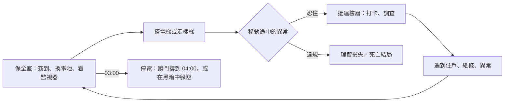

# 《夜巡守則・七樓》3D 版遊戲設計文件

> 第一人稱 3D 恐怖・網頁（桌面滑鼠鍵盤／手機觸控）・三個夜晚，約 30 分鐘
> 與文字版共用同一棟大樓、同一套守則與 12 個結局；玩法從「選擇」改成「身體的動作」。

---

## 1. 一句話概念

**你拿著手電筒在福安大廈巡邏。守則叫你不要回頭、不要動、不要開門、不要回答，而這些全都是你的手指隨時可以做到的事。**

## 2. 從文字版到 3D：設計轉譯

文字版的每個選項，在 3D 版變成一個需要「忍住」的動作。誘惑永遠在畫面上：互動提示就在眼前，鍵就在手指下。

| 守則 | 文字版 | 3D 版的身體動作 |
| --- | --- | --- |
| 第 2 條：4 樓開門不要出去、不要按按鈕 | 選「不動」 | 電梯門在 4 樓打開 9 秒。你可以走、可以按「關門鍵」，守則叫你什麼都別做 |
| 第 3 條：看到其他樓層，轉身下樓不要回頭 | 選「轉身下樓」 | 系統自動帶你下樓，但你的視角是自由的，背後有腳步聲。只要轉頭超過約 120°，就算回頭 |
| 第 5 條：不論誰敲門都不要開 | 選「不開門」 | 保全室的門上一直有「門外的聲音」提示。聲音會叫你的名字，按下去就是開門 |
| 第 6 條：13 個畫面就關螢幕，十分鐘後再開 | 選「關掉螢幕」 | 監視器是真的畫面（即時渲染其他樓層）。盯著第 13 個畫面超過 2.6 秒會付出代價；十分鐘不到就重開，它還在 |
| 第 8 條：不要用別處找到的電池 | 選「不理它」 | 手電筒電量是真實資源，B1 的免費電池是真的誘惑 |
| 第 12 條（假）：有人叫你一定要回答 | 選「回答」 | 樓梯上方有人叫你，畫面出現「回答」提示，按下去就死 |
| 第 13 條＋線索 c4：照著影子走 | 選「照著影子」 | 七樓走廊有一盞燈在你背後，你的影子真的投在地上。你必須低頭、手電筒照著影子往前走；抬頭或轉身超過 1.8 秒就失敗 |
| 老陳：「不要回頭」 | 選「不回頭」 | 回程燈在身後，地上有兩個影子，走到一半變三個。轉頭看就失去他 |

## 3. 設計支柱

1. **身體記得守則**：違規不是點錯選項，而是手癢、好奇、反射動作。
2. **光是資源，也是危險**：手電筒會沒電；03:00 停電時，開著手電筒等於告訴它你在哪裡。
3. **低解析度的恐懼**：刻意用 270p 內部解析度、色階量化、Bayer 抖色與顆粒，讓簡單的幾何看起來像一卷舊監視錄影帶，留給想像力空間。
4. **即時時鐘**：現實 1.2 秒等於遊戲 1 分鐘。03:00 前要回到保全室，05:00 七樓的門會開，都需要規劃。

## 4. 核心循環

## 5. 系統

| 系統 | 規格 |
| --- | --- |
| 時間 | 22:30 簽到開始計時，06:00 停在原地等你簽退。坐在保全室椅子上時間 ×8 |
| 手電筒 | 約 230 秒的電量；剩 15% 會閃爍；在保全室電池櫃隨時可換 |
| 理智 | 亮著燈的保全室 +0.3／秒（坐下 +1.2）；黑暗中沒開手電筒 −0.22／秒；它在 5 公尺內 −1.1／秒；事件扣分見下表。歸零即結局「新的住戶」，畫面標出死因與地點 |
| 打卡 | B1、2F、3F、5F、6F 的牆上打卡鐘。第一、二夜都沒打滿就被開除 |
| 03:00 停電 | 在保全室：門自動鎖上，17 分之後開始敲門。不在保全室：它在你所在的樓層出現，每 1.25 秒逼近一步。開手電筒時一次走 2.1 公尺，關掉後 1.1 公尺；躲在房間裡關掉手電筒，它只會停在門口 |
| 低理智 | 理智低於 20，手電筒會抖（光圈晃動），七樓的影子更難對準 |

## 6. 三夜事件

| 夜 | 地點 | 事件 | 考驗 |
| --- | --- | --- | --- |
| 一 | 電梯（第一次搭） | 停在 4 樓，黑暗、燒香味、一群人在等電梯 | 第 2 條 |
| 一 | 樓梯（00:00 後從 3F、5F 往上） | 7F 標示；往上會繞三圈，往下要忍住不回頭 | 第 3 條 |
| 一 | 保全室 | 第十三個畫面 | 第 6 條 |
| 一 | 3F 教室 | 找媽媽的男孩（對話） | 第 7 條 |
| 一 | B1 | 一盒全新的電池 | 第 8 條 |
| 一 | 2F | 十年前的新聞 | 氛圍 |
| 一 | 5F | 寫滿「陳」的值班表，最後一格是你的名字 | 氛圍 |
| 一 | 6F | 打卡鐘縫隙裡的紙條（線索 c1：陳／陣） | 線索 |
| 一 | 03:00 | 主任的聲音敲門 | 第 5 條 |
| 二 | 保全室 00:10–01:00 | 電話響（定位音效），來電顯示林主任 | 第 9 條 |
| 二 | 樓梯 | 7F＋紅字「繼續往上」；往上就死 | 第 3 條 vs 第 10 條 |
| 二 | 電梯 | 4 樓燈亮著，走廊盡頭有人在招手 | 第 2 條 |
| 二 | 2F | 穿睡衣的阿姨 | 第 7 條 |
| 二 | 3F | 白板（線索 c5） | 線索 |
| 二 | B1 | 引擎在轉、沒人的車（線索 c2：反章） | 線索 |
| 二 | 保全室 | 第十三個畫面裡的老陳舉著「五點」（線索 c3） | 線索 |
| 二 | 6F | 有人在頂樓門後刮門、叫你的名字 | 氛圍 |
| 二 | 03:00 | 「老陳」敲門，可以問他「陳怎麼寫」 | 第 5 條、陳／陣 |
| 三 | 保全室 | 十二個畫面全都是七樓走廊 | 第 6 條，線索 c4 |
| 三 | 電梯 | 面板多了一顆亮著的「7」；4 樓的人全背對你 | 第 2 條 |
| 三 | 樓梯 | 有人叫你的名字，畫面出現「回答」 | 第 12 條（假） |
| 三 | 2F | 和你長得一樣的人 | 第 7 條 |
| 三 | 3F | 坐滿學生的教室：「福安大廈共有幾層？」 | 氛圍 |
| 三 | 5F | 隔板上寫滿紅字（線索 c4） | 線索 |
| 三 | B1 | 三個林主任：「三點記得上頂樓」 | 指向假的第五條 |
| 三 | 03:00 | 照假第五條在 6F 等就會死；在保全室，門外是你自己的聲音 | 第 5 條 vs 第 5′ 條 |
| 三 | 05:00 | 6F 往上，七樓的門開著。影子走廊、老陳的問題、不回頭的回程 | 第 13 條、c4、陳／陣 |
| 三 | 06:00 | 日誌下班欄已經有你的簽名 | 第 11 條 |

## 7. 七樓走廊（全作高潮）

1. 進門後，背後的燈把你的影子投在地上。手電筒在這裡只剩四分之一亮度。
2. 必須持續低頭（俯角超過約 18°）、手電筒開著、面朝走廊。偏離 0.6 秒會有警告閃光與低語，偏離 1.8 秒就是結局「沒有影子」。
3. 身後依序傳來林主任、媽媽、你自己的聲音（HRTF 定位在你背後 3.5 公尺）。轉身就失敗。
4. 走到盡頭，老陳問「你是誰」與「陳怎麼寫」。答「耳車陣」會失去他。
5. 回程：燈換到老陳那一頭，地上出現兩個影子，走到一半變成三個。轉頭就只剩一支紅筆。
6. 成功後，老陳會一路跟在你身後，06:00 一起推開大廳的玻璃門，進入真結局「交班」。

## 8. 技術

- **引擎**：three.js 0.149（從 jsDelivr 載入，失敗時改用 unpkg）。其他全部自己寫，沒有額外資源檔。
- **大樓**：8 個區域（B1、1F、2F、3F、4F、5F、6F、7F），沿 X 軸相隔 200 公尺。上下樓在黑幕中傳送；所有樓層的電梯車廂與樓梯平台共用同一套模板，所以傳送前後看不出接縫。
- **貼圖**：全部 canvas 程序化產生（磁磚、油漆牆、天花板、水泥、地毯、招牌、紅筆字、白板、日誌、值班表、監視器新聞）。用世界座標計算 UV，牆面無縫接續。
- **燈光**：固定 4 盞點光源，進入區域時移到該層的日光燈位置，避免 shader 重新編譯；另有一盞手電筒聚光燈，以及一盞只在七樓使用、會投影的輔助聚光燈。
- **監視器**：12 台攝影機輪流渲染進 512×288 的貼圖集，每幀更新 2 格；第 13 台另有自己的貼圖。螢幕用自訂 shader 加上掃描線、雜訊與暗角。
- **後製**：場景先渲染到 270p 的渲染目標，再用一次全螢幕 shader 做色差、灰階、Bayer 抖色、26 階量化、顆粒、暗角，以及理智越低越強的畫面扭曲。
- **音效**：Web Audio 即時合成。定位音效（敲門、電話、腳步、低語、呼吸、引擎）走 HRTF；人聲是沒有字詞的共振峰低語，意思交給字幕。
- **腳本**：每一夜的事件寫在 `director.js`，用 async 函式描述時間序列。引擎提供 `G.wait`、`G.waitUntil`、`G.say`、`G.choice`、`G.rail`、`G.onFrame` 等介面；結局或重來時所有腳本會一起中止。
- **輸入**：桌面用滑鼠鎖定（無法鎖定時自動改成拖曳視角）；手機用左下虛擬搖桿、右半邊拖曳看、互動與手電筒按鈕。

## 9. 測試

`tests/smoke-3d.cjs` 用 Playwright（SwiftShader 軟體 WebGL）實際跑過：簽到、電梯 4 樓停靠、樓梯 7F 異常與回 1F、03:00 開門死亡，以及第三夜七樓影子走廊救出老陳、推門得到真結局，並檢查沒有任何頁面錯誤。
