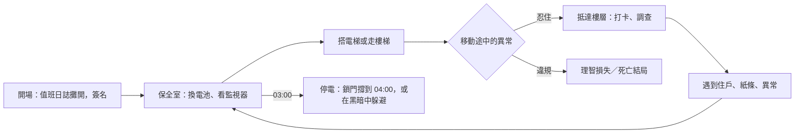

# 《夜巡守則・七樓》3D 版遊戲設計文件

> 第一人稱 3D 恐怖・網頁（桌面滑鼠鍵盤／手機觸控）・三個夜晚，約 30 分鐘
> 與文字版共用同一棟大樓與故事；3D 版的守則與紙條改成「兩個管道」的設計（見第 7.5 節與 `docs/RULES-PLAN.md`），共有 13 個結局。玩法從「選擇」改成「身體的動作」。

---

## 1. 一句話概念

**你拿著手電筒在福安大廈巡邏。守則叫你不要回頭、不要動、不要開門、不要回答，而這些全都是你的手指隨時可以做到的事。**

## 2. 從文字版到 3D：設計轉譯

文字版的每個選項，在 3D 版變成一個需要「忍住」的動作。誘惑永遠在畫面上：互動提示就在眼前，鍵就在手指下。

| 守則 | 文字版 | 3D 版的身體動作 |
| --- | --- | --- |
| 第 2 條：4 樓開門不要出去、不要按按鈕 | 選「不動」 | 電梯門在 4 樓打開 9 秒。你可以走、可以按「關門鍵」，守則叫你什麼都別做 |
| 第 3 條：看到其他樓層，轉身下樓不要回頭 | 選「轉身下樓」 | 系統自動帶你下樓，但你的視角是自由的，背後有腳步聲。只要轉頭超過約 120°，就算回頭 |
| 第 5 條：不論誰敲門都不要開 | 選「不開門」 | 保全室的門上一直有「門外的聲音」提示。聲音會叫你的名字，按下去就是開門 |
| 第 6 條：13 個畫面就關螢幕，十分鐘後再開 | 選「關掉螢幕」 | 監視器是真的畫面（即時渲染其他樓層）。盯著第 13 個畫面超過 2.6 秒會付出代價；十分鐘不到就重開，它還在 |
| 第 8 條：不要用別處找到的電池 | 選「不理它」 | 手電筒電量是真實資源，B1 的免費電池是真的誘惑 |
| 紅筆第 10 條（假）：有人叫你一定要回答 | 選「回答」 | 樓梯上方有人叫你，畫面出現「回答」提示，按下去就死 |
| 2F 紙條（五點）＋線索 c4：照著影子走 | 選「照著影子」 | 七樓走廊有一盞燈在你背後，你的影子真的投在地上。你必須低頭、手電筒照著影子往前走；抬頭或轉身超過 1.8 秒就失敗 |
| 老陳：「不要回頭」 | 選「不回頭」 | 回程燈在身後，地上有兩個影子，走到一半變三個。轉頭看就失去他 |

## 3. 設計支柱

1. **身體記得守則**：違規不是點錯選項，而是手癢、好奇、反射動作。
2. **光是資源，也是危險**：手電筒會沒電；03:00 停電時，開著手電筒等於告訴它你在哪裡。
3. **低解析度的恐懼**：刻意用 270p 內部解析度、色階量化、Bayer 抖色與顆粒，讓簡單的幾何看起來像一卷舊監視錄影帶，留給想像力空間。
4. **即時時鐘**：現實 1.2 秒等於遊戲 1 分鐘。03:00 前要回到保全室，05:00 七樓的門會開，都需要規劃。

## 4. 核心循環

## 5. 系統

| 系統 | 規格 |
| --- | --- |
| 簽到 | 每一夜的開場卡之後，值班日誌直接攤開在眼前：前幾天的簽名（老陳 10/10 沒有簽退）、今天這一行由你簽。第一夜同時填名字；之後名字已經寫好，按「簽名」即可。簽完才開始計時，不會有「沒簽到就去打卡」的狀況 |
| 時間 | 22:30 開始，06:00 停在原地等你簽退。節奏分段：22:30–02:40 巡邏時段 2.2 秒＝1 分鐘（約 9 分鐘，留給打卡與探索）；02:40–04:00 收緊為 1.2 秒；04:00–06:00 為 1.6 秒。翻守則、做選擇、讀紙條時時間暫停；七樓走廊裡時鐘停止。坐在保全室椅子上時間 ×8，打完五個卡可以坐著快轉 |
| 手電筒 | 約 280 秒的電量；剩 15% 會閃爍；在保全室電池櫃隨時可換 |
| 理智 | 亮著燈的保全室 +0.3／秒（坐下 +1.2）；黑暗中沒開手電筒 −0.22／秒；它在 5 公尺內 −1.1／秒；事件扣分見下表。歸零即結局「新的住戶」，畫面標出死因與地點 |
| 打卡 | B1、2F、3F、5F、6F 的牆上打卡鐘；HUD 列出五層，打過的會亮起。第一、二夜都沒打滿就被開除 |
| 03:00 停電 | 在保全室：門自動鎖上，17 分之後開始敲門。不在保全室：它在你所在的樓層出現，每 0.7 秒逼近一步。開手電筒或在跑時，它看得見、聽得見你，一步 1.8 公尺（約每秒 2.6 公尺，比走路快、比跑步慢）；關燈慢慢走，一步 0.9 公尺（約每秒 1.3 公尺）；躲在房間裡、關燈、不跑，它只會停在門口。它沿著走廊中線與房門口走，不穿牆；你沒在看它、而且相隔 7 公尺以上時，偶爾會無聲地一下子「跳」近（最多 4.5 公尺，不會直接貼到你身上） |
| 第十三個畫面 | 22:55 之後第一次回到保全室時出現（第三夜是全部畫面）。守則：關閉螢幕，十分鐘後再開。太早打開 −5。盯著看約 2.6 秒：鏡頭推近，第一夜老陳回頭（−15），第二、三夜拿到線索（−15／−12）。不理它：每次離開再回來、或在房間裡放著不管 45 秒，畫面裡的「它」就近一步——走廊中間（−5）→ 鏡頭正下方抬頭看你（−8）→ 第三次，畫面變成保全室，它站在你背後（−20，畫面才消失）。不理它是代價最高的選擇 |
| 跑步 | 按住 Shift（手機按住「跑」；搖桿推到底不再自動跑）。每秒 3.8 公尺，走路 2.3。代價有兩個：03:00 停電時會被它聽見；跑越久越喘（最多累積 5 秒），喘的時候四周有位置的聲音（它的腳步與呼吸、門後的聲音、背後的低語）變小變悶，自己的喘氣聲蓋過一切。第一次喘到會提示一次。七樓走廊與帶老陳回程時不能跑。演出與死亡場面中不喘，免得蓋掉演出的聲音 |
| 操作提示 | 開場只提示「WASD 移動・滑鼠看・E 互動」與守則鍵。其餘在需要的那一刻才出現在準心下方，做到就淡出，每份存檔只出現一次（開新遊戲才重置，重來這一夜不會）：第一夜第一次走進 B1 或沒燈的地方而且沒開手電筒 →「F 打開手電筒」；第一夜電量剩 30% →「保全室門邊的櫃子可以換電池」；第一夜連續走超過 6 公尺 →「Shift 按住跑步」；第一次喘起來 →「喘的時候，聽不清楚四周的聲音」。演出、對話、選擇、03:00–04:00 不出現，被打斷的提示之後會再出現。暫停選單可以關掉 |
| 看不見的導演 | 03:00 以外也讓玩家覺得它在附近：身後的腳步（一回頭就停）、走廊另一頭的關門聲、整層燈閃、走廊盡頭站著一個人（你看它就消失；第三夜是你自己）、房門後的低語、電梯自己叮一聲、牆的另一邊敲兩下。都不會死，各扣 1–3 理智。約每 55–85 秒一次；理智低於 45、25 會更頻繁，04:00 之後更頻繁，第一夜較少。演出、選擇、02:58–04:00、保全室裡、4F、7F、電話在響、帶著老陳、06:00 之後都不出現 |
| 05:00 重來點 | 第三夜 05:00 之後要從 6F 走上七樓時記下狀態（理智、電量、打卡、線索、旗標）。之後在第三夜失敗或沒救出老陳，結局畫面多一個「從 05:00 重來」，回到 6F 樓梯口再試；「重來這一夜」仍然從頭開始 |
| 巡邏紀錄 | 每夜結算寫在值班日誌上，只記「你做了什麼」，不記結果：電梯停 4 樓、樓梯出現 7F、03:00 在哪裡、門外的聲音、第十三個畫面、住戶、停車場的電池、電話。第二夜起會混進一行你沒做過的事，用紅筆寫（例如「你接了電話，上了頂樓」），玩家要自己分辨 |
| 低理智 | 理智低於 20，手電筒會抖（光圈晃動），七樓的影子更難對準 |

## 6. 三夜事件

| 夜 | 地點 | 事件 | 考驗 |
| --- | --- | --- | --- |
| 一 | 電梯（第一次搭） | 停在 4 樓，黑暗、燒香味、一群人在等電梯 | 第 2 條 |
| 一 | 樓梯（00:00 後從 3F、5F 往上） | 7F 標示；往上會繞三圈，往下要忍住不回頭 | 第 3 條 |
| 一 | 保全室 | 第十三個畫面 | 第 6 條 |
| 一 | 3F 教室 | 找媽媽的男孩（對話） | 第 7 條 |
| 一 | B1 | 一盒全新的電池 | 第 8 條 |
| 一 | 2F | 十年前的新聞 | 氛圍 |
| 一 | 5F | 寫滿「陳」的值班表，最後一格是你的名字 | 氛圍 |
| 一 | 6F | 打卡鐘縫隙裡的紙條（線索 c1：老陳不寫在守則上，只用打卡鐘紙條） | 線索 |
| 一 | 03:00 | 主任的聲音敲門 | 第 5 條 |
| 二 | 保全室 00:10–01:00 | 電話響（定位音效），來電顯示林主任 | 3F 紙條（電話不要接） |
| 二 | 樓梯 | 7F＋紅字「繼續往上」；往上就死 | 第 3 條 vs 紅筆第 9 條 |
| 二 | 電梯 | 4 樓燈亮著，走廊盡頭有人在招手 | 第 2 條 |
| 二 | 2F | 穿睡衣的阿姨 | 第 7 條 |
| 二 | 3F | 白板（線索 c5） | 線索 |
| 二 | B1 | 引擎在轉、沒人的車（線索 c2：反章） | 線索 |
| 二 | 保全室 | 第十三個畫面裡的老陳舉著「五點」（線索 c3） | 線索 |
| 二 | 6F | 有人在頂樓門後刮門、叫你的名字 | 氛圍 |
| 二 | 03:00 | 「老陳」敲門，可以問他「陳怎麼寫」 | 第 5 條、陳／陣 |
| 三 | 保全室 | 十二個畫面全都是七樓走廊 | 第 6 條，線索 c4 |
| 三 | 電梯 | 面板多了一顆亮著的「7」；4 樓的人全背對你 | 第 2 條 |
| 三 | 樓梯 | 有人叫你的名字，畫面出現「回答」 | 紅筆第 10 條（假，署名陳） |
| 三 | 2F | 和你長得一樣的人 | 第 7 條 |
| 三 | 3F | 坐滿學生的教室：「福安大廈共有幾層？」 | 氛圍 |
| 三 | 5F | 隔板上寫滿紅字（線索 c4） | 線索 |
| 三 | B1 | 三個林主任：「三點記得上頂樓」 | 指向假的第五條 |
| 三 | 03:00 | 照假第五條在 6F 等就會死；在保全室，門外是你自己的聲音 | 第 5 條 vs 第 5′ 條 |
| 三 | 05:00 | 6F 往上，七樓的門開著。影子走廊、兩個老陳、不回頭的回程 | 2F 紙條、c2、c4 |
| 三 | 06:00 | 日誌下班欄已經有你的簽名 | 5F 紙條 |

## 7. 七樓走廊（全作高潮）

1. 進門後，背後的燈把你的影子投在地上。手電筒在這裡只剩四分之一亮度。
2. 必須持續低頭（俯角超過約 18°）、手電筒開著、面朝走廊。偏離 0.6 秒會有警告閃光與低語，偏離 1.8 秒就是結局「沒有影子」。
3. 身後依序傳來林主任、媽媽、你自己的聲音（HRTF 定位在你背後 3.5 公尺）。轉身就失敗。
4. 走到盡頭，**兩個老陳**一左一右坐著，背對你在牆上寫字，名牌都是「陳」，都說「是你嗎？帶我回去」。左右每局隨機。
   - 真的老陳：地上的燈把他的影子照在牆上；面前那半面牆的字是正的。
   - 它：牆上沒有影子（「它沒有影子」，線索四）；面前的字整面是反的（「它描出來都是反的」，線索二）。
   - 走上前拍其中一人的肩膀，帶他走。走回走廊不選，就是一個人離開。
5. 回程：燈換到盡頭那一頭，你走前面、照著影子、不能回頭。
   - 帶對了：地上兩個影子，走到一半變成三個。轉頭就只剩一支紅筆（失去老陳）。
   - 帶錯了：地上只有你自己的影子，身後卻一直有腳步聲。轉頭會看到它（名牌的字是反的），它說「你看到了」然後消失；走廊盡頭只剩真的那個，可以再上去一次。沒有回頭就帶著它走出去，06:00 推門時進入結局「帶錯了人」。
6. 帶對了，老陳會一路跟在你身後，06:00 一起推開大廳的玻璃門，進入真結局「交班」。

### 7.5 守則與紙條（3D 版）

| 管道 | 誰寫的 | 真假 |
| --- | --- | --- |
| 守則本上印的字（第 1–8 條） | 公司 | 真；第三夜第二頁被它換掉，章是反的（假第 5 條、假頁尾） |
| 守則本上的紅筆字（第 9、10 條） | 一律是它 | 假；第二夜署名「陣」，第三夜學會描「陳」 |
| 打卡鐘裡的紙條 | 老陳，蓋正的章 | 真；第三夜 B1 那張是它描的，章是反的 |

紙條位置：第一夜 6F（老陳的規則：我不會寫在守則上）；第二夜 3F（電話不要接）；第三夜 5F（日誌已有你的簽名不要簽）、2F（五點，七樓；走廊盡頭不會只有我一個）、B1（假：03:00 去頂樓）。打卡之後紙條會從打卡鐘縫隙露出來，紙條上看得到章的方向。

## 8. 表現力

### 8.1 人物

- 每個人物都有骨架：骨盆、脊椎、頸、頭、肩、肘、手、髖、膝，全部可以轉動。身形依角色分開（小孩頭大腿短、「它」細長手長、林主任較寬）。
- 臉與衣服是程序化貼圖：老陳的皺紋與鬍渣、男孩的大眼睛、阿姨垂下來的長髮、住戶沒有五官的臉、你的分身與你同一張臉。名牌會寫上名字（老陳、你自己）。
- 動作模式：`idle`（呼吸）、`write`（老陳在牆上寫字）、`beckon`（四樓的保全招手）、`hold`（舉著紙）、`swing`（男孩晃腳）、`rock`（阿姨蹲著搖）、`twitch`（「它」抽動）、`walk`、`lean`（往前湊）。
- 視線追蹤：人物可以一直轉頭盯著鏡頭；男孩從背後被接近時，頭會轉過身體轉不到的角度。

### 8.2 樓層辨識度

每層都有自己的燈色、霧色與佈置，電梯門口有樓層牌：

| 樓層 | 燈色 | 環境敘事 |
| --- | --- | --- |
| B1 | 鈉燈橘 | 積水、柱子上的警示條與車位編號、繳費機、滴水聲 |
| 2F 牙醫 | 冷青 | 叫號機、衛教海報、盆栽、牆上的水痕 |
| 3F 補習班 | 暖黃 | 金榜題名的榜單、書包、停在 3 點的鐘、孩子的畫 |
| 4F | 昏黃 | 花圈（音容宛在）、香爐、香煙 |
| 5F 招租 | 藍灰 | 紙箱、蓋著白布的家具、散落的文件、招租布條、地上一支手機 |
| 6F 機房 | 綠 | 頂樓鐵門上的符、警示斑馬線、「高壓危險」、紅色警示燈 |
| 7F | 只有紅筆字 | 滿牆守則、地上的紙與紅筆 |

### 8.3 少一點閱讀

- 內心獨白幾乎全部拿掉。需要玩家注意的東西，改用鏡頭帶過去（`G.lookAt`）、推近（`G.fov`），或用聲音提示。
- 事件的描述直接寫進選項的題目，不再先跳一段獨白再跳選項。
- 只留下真的需要文字的地方：人物的台詞、紙條與守則、理智太低時進七樓前的警告。

### 8.4 死亡場面

每一種死法都有 3D 場面。死亡時進入電影模式（上下黑邊、隱藏 HUD、玩家不能控制），演完才淡出到結局卡。

| 結局 | 場面 |
| --- | --- |
| 敲門聲 | 門開了，門口站著細長的「它」在抽動；燈閃一下，它就在你面前 |
| 四樓 | 電梯門在身後關上；所有人轉過來，燈每閃一次就近一步 |
| 七樓 | 一直往上，7F、7F、7F；最後抬頭，上面的樓梯站滿往下看的人 |
| 主任的電話 | 頂樓，風很大；林主任背對你，慢慢轉身，臉上貼著一頁守則 |
| 第五條 | 門後是無盡的走廊；鐵門關上，燈從遠處一盞一盞熄到你面前 |
| 有人叫你 | 回答之後，燈一熄一亮，上面的樓梯站滿人，一起笑，「找到了」 |
| 沒有影子 | 光裡什麼都沒有；低頭，影子不見了；你的分身說「謝謝」，走下樓 |
| 重複的簽名 | 天亮了，玻璃門推不開；早餐店老闆走過去，沒看你一眼；新人走進來 |
| 新的住戶（理智歸零） | 住在這裡的人一個一個圍過來，你慢慢坐到地上 |
| 天亮了 | 走出大門，回頭，老陳還站在大廳裡 |
| 交班 | 和老陳一起走進早晨，早餐店老闆：「老陳，好久不見。照舊？」 |
| 帶錯了人 | 走進早晨，早餐店老闆問「你一個人？」；回頭，他就在你身後，地上只有你的影子 |

## 9. 技術

- **引擎**：three.js 0.149（從 jsDelivr 載入，失敗時改用 unpkg）。其他全部自己寫，沒有額外資源檔。
- **大樓**：8 個區域（B1、1F、2F、3F、4F、5F、6F、7F），沿 X 軸相隔 200 公尺。上下樓在黑幕中傳送；所有樓層的電梯車廂與樓梯平台共用同一套模板，所以傳送前後看不出接縫。
- **貼圖**：全部 canvas 程序化產生（磁磚、油漆牆、天花板、水泥、地毯、招牌、紅筆字、白板、日誌、值班表、監視器新聞）。用世界座標計算 UV，牆面無縫接續。
- **燈光**：固定 4 盞點光源，進入區域時移到該層的日光燈位置，避免 shader 重新編譯；另有一盞手電筒聚光燈，以及一盞只在七樓使用、會投影的輔助聚光燈。
- **監視器**：12 台攝影機輪流渲染進 512×288 的貼圖集，每幀更新 2 格；第 13 台另有自己的貼圖。螢幕用自訂 shader 加上掃描線、雜訊與暗角。
- **後製**：場景先渲染到 270p 的渲染目標，再用一次全螢幕 shader 做色差、灰階、Bayer 抖色、26 階量化、顆粒、暗角，以及理智越低越強的畫面扭曲。
- **音效**：Web Audio 即時合成。定位音效（敲門、電話、腳步、低語、呼吸、引擎）走 HRTF；人聲是沒有字詞的共振峰低語，意思交給字幕。
- **腳本**：事件寫在 `3d/js/director/`，按主題分檔：base（共用狀態與演出工具）、flow（每一夜的流程、結算紀錄、05:00 重來）、threeam（03:00 與它的路線）、cctv（第十三個畫面）、phone（電話與電梯）、seventh（7F）、events（住戶與物件）、ambient（看不見的導演），index 是 main.js 唯一認得的介面。用 async 函式描述時間序列。引擎提供 `G.wait`、`G.waitUntil`、`G.say`、`G.choice`、`G.rail`、`G.onFrame`、`G.lookAt`、`G.fov`、`G.cine`、`G.figure`（可 `walkTo`、`turn`、`anim`、`track`）等介面；結局或重來時所有腳本會一起中止。
- **輸入**：桌面用滑鼠鎖定（無法鎖定時自動改成拖曳視角）；手機用左下虛擬搖桿、右半邊拖曳看、互動與手電筒按鈕。

## 10. 測試

測試時用 `NP3D_DEBUG.setSpeed(n)` 讓每畫一幀模擬 n 步（遊戲邏輯照常、只是不必等軟體渲染），`tests/smoke-3d.cjs` 預設 4 倍，整套從六分多鐘縮到約兩分鐘；`NP3D_SPEED=1` 可以關掉。

`tests/smoke-3d.cjs` 用 Playwright（SwiftShader 軟體 WebGL）實際跑過：簽到、電梯 4 樓停靠、樓梯 7F 異常與回 1F、03:00 開門死亡，以及第三夜七樓影子走廊救出老陳、推門得到真結局，並檢查沒有任何頁面錯誤。
